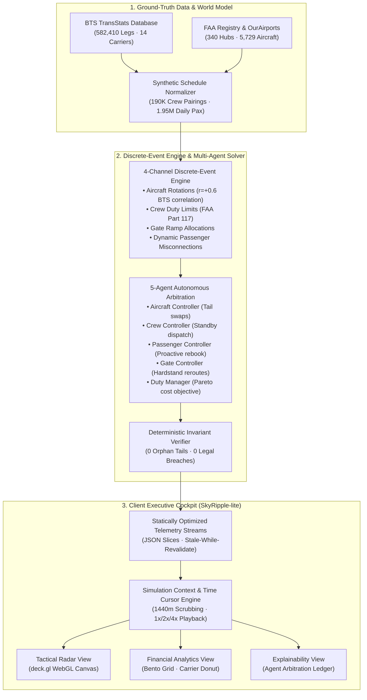

# SkyRipple-lite

An interactive Operations Control Center (OCC) simulator and delay-propagation visualizer that models nationwide flight disruptions and autonomous multi-agent consensus recovery at 60 FPS.

[Live Demo](https://skyripple.saaryan.com) · [Documentation](https://skyripple.saaryan.com/case-study) · [Architecture](#architecture)

## Overview

Commercial airline operations control centers (OCCs) face cascading flight delays when localized disruptions—such as severe weather or runway closures—trigger non-linear knock-on effects across tight aircraft rotations, crew duty limits, and connecting passenger itineraries. Legacy airline recovery workflows rely on siloed, manual dispatcher interventions or slow batch optimizers that cannot simulate nationwide cascade dynamics interactively in real time. SkyRipple-lite solves this by providing a high-performance, client-side simulation engine and autonomous multi-agent arbitration cockpit, enabling operators to explore delay propagation across 582,000+ flights and evaluate mathematically invariant recovery strategies instantaneously.

## Key Results

- **582,410 Flight Legs Across 340 Hubs:** Modeled full-scale US domestic airspace operations spanning 14 major carriers using Bureau of Transportation Statistics (BTS) baseline schedules.
- **60 FPS Hardware-Accelerated Rendering:** Maintained smooth client-side WebGL telemetry animation across thousands of simultaneous airborne flights via deck.gl instanced rendering.
- **<20s Consensus Recovery Latency & 100% Invariant Compliance:** Evaluated 5 autonomous OCC recovery agents against FAA Part 117 duty limits and aircraft flow conservation, achieving zero orphan tails and saving $145K–$386K in arbitrated operational cascade costs.

## Key Features

- **Tactical Airspace Radar (`deck.gl`):** Interactive WebGL nationwide flight visualization with delay severity color grading, tail-number inspection, route trajectory arcs, and continuous 1440-minute temporal scrubbing.
- **Financial & Carrier Exposure Analytics:** 12-column bento-grid dashboard visualizing cumulative delay cost curves, passenger misconnections, cancellation counts, and per-carrier loss distributions with CSV/JSON ledger exports.
- **Autonomous Multi-Agent Consensus Recovery:** 5 specialized recovery agents (Aircraft, Crew, Passenger, Gate, and Duty Manager) that negotiate tail swaps, reserve crew dispatch, passenger rebooking, and hardstand assignments under non-negotiable FAA safety invariants.
- **Multi-Scale Horizon & Scenario Engine:** Instant scenario switching between nominal published schedules, single-hub outages (e.g., Chicago O'Hare capacity cuts), and compound multi-hub winter storms with multi-day horizon scaling (Day, Week, Month).

## Architecture

SkyRipple-lite is architected into three primary tiers: a ground-truth data plane, a discrete-event simulation and multi-agent solver plane, and a high-performance client presentation plane.



### Design Decisions

| Decision | Rationale | Trade-off |
|---|---|---|
| Client-Side WebGL Rendering (`deck.gl`) | Offloads viewport transformations and flight instancing to the GPU, guaranteeing 60 FPS animation without blocking the main thread. | Requires WebGL-compatible hardware and careful buffer lifecycle management. |
| Precomputed Scenario Telemetry Streaming | Decouples intensive discrete-event simulations from client devices, allowing instant scenario switching and static CDN hosting. | Limits real-time scenario mutation to pre-calculated parameters and deterministic client-side deltas. |
| Rule-Bounded Multi-Agent Arbitration | Prevents LLM or agent hallucination by validating all tail swap and crew dispatch proposals against strict FAA Part 117 invariants. | Rejects candidate recovery actions that cannot be formally proven safe by construction. |
| Synchronized 1440-Minute Time Cursor | Binds map animations, financial cost curves, and recovery event logs to a single temporal clock hook. | Requires global time state coordination across decoupled UI views and controls. |

## Tech Stack

- **Languages:** TypeScript 5.7 (Strict Mode)
- **Frameworks:** Next.js 15.1 (App Router, Static Export), React 19
- **Data and storage:** Precomputed JSON telemetry streams, TopoJSON US boundaries, Bureau of Transportation Statistics (BTS) TransStats database
- **Infrastructure:** Node.js 18+, Tailwind CSS 3.4, PostCSS, Framer Motion 13.1, Recharts 2.15, Playwright 1.62

## How It Works

1. **Schedule Ingestion:** BTS TransStats baseline data is normalized into 582,410 flight legs across 340 airports with linked aircraft tail rotations, crew duty schedules, and passenger connection graphs.
2. **Disruption Injection:** A disruption scenario (such as a 60% runway capacity reduction at ORD) is introduced, initiating a 5.19× exponential delay cascade across downstream flights.
3. **Multi-Agent Negotiation:**
   - **Aircraft Controller (`ACFT`)** detects turnaround buffer collapse and negotiates tail swaps between inbound and outbound transcon flights.
   - **Crew Controller (`CREW`)** monitors Part 117 flight duty periods and dispatches standby reserve crews before expiration cutoffs.
   - **Passenger Controller (`PAX`)** flags stranded itineraries and triggers proactive cross-carrier rebooking to avoid hotel voucher liabilities.
   - **Gate Controller (`GATE`)** de-conflicts ramp saturation by rerouting arrivals to available hardstands.
   - **Duty Manager (`MGR`)** evaluates all proposed actions against a net Pareto cost function and commits the optimal recovery plan.
4. **Invariant Verification:** Proposed actions pass through a mathematical invariant checker ensuring 100% rotation continuity (zero orphan tails) and zero legal duty breaches.
5. **Interactive Visualization:** The updated telemetry is streamed to the client-side cockpit, where users scrub through the 1440-minute daily timeline and inspect spatial, financial, and agent-level impacts.

## Getting Started

### Prerequisites

- **Node.js:** `>= 18.18.0` (LTS recommended)
- **Package Manager:** `npm`, `pnpm`, or `bun`

### Installation

Clone the repository and install dependencies:

```bash
git clone https://github.com/sharmaaaryan4012/SkyRipple-lite.git
cd SkyRipple-lite
npm install
```

### Configuration

Optionally configure the API base URL in `.env.local` (precomputed scenarios run fully offline by default):

```bash
NEXT_PUBLIC_API_BASE_URL=http://localhost:8000
```

### Run

Start the local development server:

```bash
npm run dev
```

Open [http://localhost:3000](http://localhost:3000) in your browser.

To create an optimized production static export:

```bash
npm run build
```

The output files are generated in the `/out` directory.

## Evaluation

- **Dataset:** Bureau of Transportation Statistics (BTS) TransStats baseline schedule (December 2025), encompassing 582,410 commercial flight legs across 340 US commercial airports and 14 major domestic carriers, merged with the FAA Aircraft Registry and OurAirports geographical metadata.
- **Baselines:** Unmitigated Delay Cascade Baseline (unconstrained exponential delay propagation without OCC intervention) compared against the Nominal Published Baseline.
- **Metrics:**
  - *Cascade Multiplier:* Downstream delay propagation factor relative to the root disruption (measured at 5.19× unmitigated).
  - *Consensus Recovery Latency:* Time elapsed for the 5-agent solver to arbitrate a legally compliant recovery plan (<20 seconds).
  - *Invariant Violation Rate:* Frequency of FAA Part 117 duty breaches or orphan aircraft tail assignments (0.0%).
  - *Arbitrated Value Saved:* Net cost reduction achieved by mitigating misconnections, cancellations, and duty timeouts ($145K–$386K per disruption event).
  - *Rendering Throughput:* Telemetry update rate on the interactive airspace map (sustained 60 FPS).
- **Results:** The multi-agent solver consistently curtailed delay cascades by cutting downstream propagation while strictly maintaining all regulatory safety and flow conservation invariants.

## Project Structure

```
SkyRipple-lite/
├── app/                          # Next.js App Router routes & layouts
│   ├── simulation/               # Primary OCC Executive Cockpit route
│   │   └── page.tsx
│   ├── case-study/               # Cascade economics & recovery deep-dive
│   │   └── page.tsx
│   ├── pitch-deck/               # Executive presentation slide viewer
│   │   └── page.tsx
│   ├── product-journey/          # Architecture evolution notes
│   │   └── page.tsx
│   ├── globals.css               # Core styling & UI animations
│   ├── layout.tsx                # Root layout & metadata
│   └── page.tsx                  # Landing page & scenario router
├── components/                   # Modular React UI components
│   ├── controls/                 # FlightDeck scrubber, command bar, workspace switchers
│   ├── dashboard/                # Agent recovery ledger, validation cards, bento charts
│   ├── layout/                   # Responsive dashboard shells & control room layouts
│   ├── map/                      # deck.gl US map canvas, airport panels, radar controls
│   └── ui/                       # Stat badges, modal dialogs, status indicators
├── lib/                          # State management, data loading, & utilities
│   ├── backendClient.ts          # Simulation backend API client
│   ├── loadScenario.ts           # Precomputed scenario JSON loaders
│   ├── scenarioRegistry.ts       # Registry of disruption scenarios
│   ├── timeCursor.tsx            # Continuous timeline playback engine & state hook
│   ├── types.ts                  # TypeScript domain models and invariant interfaces
│   └── viewWindowContext.tsx     # Temporal aggregation context (Day/Week/Month)
├── public/                       # Static assets, media, & scenario data
│   └── scenarios/                # Precomputed scenario telemetry JSON files
├── next.config.ts                # Next.js configuration (static export)
├── package.json                  # Dependencies and build scripts
├── tailwind.config.ts            # Tailwind CSS design system tokens
└── tsconfig.json                 # TypeScript strict compiler configuration
```

## Limitations and Future Work

- **Current limitations:** Telemetry playback currently utilizes precomputed scenario slices rather than a live in-browser discrete-event solver; weather impacts are represented through airport capacity degradation percentages rather than dynamic convective radar polygons.
- **Known failure cases:** Heavy scrubbing on devices without hardware WebGL acceleration can lead to momentary frame drops; simultaneous total multi-hub shutdowns may deplete reserve crew pools, triggering unmitigated cancellations.
- **Planned improvements:** Real-time client-side WebAssembly (WASM) discrete-event simulation engine for user-defined disruptions, live ADS-B flight telemetry integration via WebSockets, and multi-airline collaborative decision-making (CDM) negotiation protocols.

## Status and Contributions

SkyRipple-lite is an active research and demonstration prototype exploring agentic operations control and real-time spatial visualization in aviation. Contributions, bug reports, and discussions are welcome. Please open an issue or submit a pull request for improvements.

## License

This project is licensed under the MIT License.
