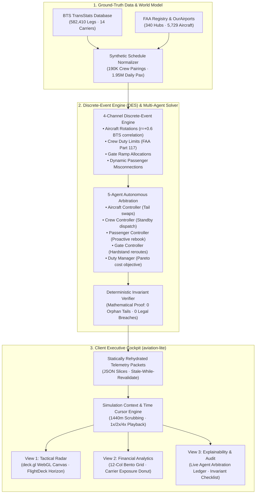

# ✈️ SkyRipple: Distributed Multi-Agent Airspace Disruption & Recovery Simulator

[](https://nextjs.org/)
[](https://react.dev/)
[](https://www.typescriptlang.org/)
[](https://deck.gl/)
[](https://tailwindcss.com/)
[](https://opensource.org/licenses/MIT)

> **Live Demo:** [skyripple.saaryan.com](https://skyripple.saaryan.com) &nbsp;|&nbsp; **Portfolio:** [saaryan.com](https://www.saaryan.com) &nbsp;|&nbsp; **Architecture Audits:** [`/audit`](./audit)

---

## 📌 Executive Summary

**SkyRipple** is an agentic US-domestic air traffic delay-propagation engine and interactive Operations Control Center (OCC) simulator. Built on empirical **Bureau of Transportation Statistics (BTS)** ground truth (December 2025 schedule baseline), SkyRipple models how isolated airport disruptions cascade through 582,410 commercial flight legs, quantifies financial loss distributions, and executes multi-agent autonomous recovery under non-negotiable FAA regulatory invariants.

This repository (`aviation-lite`) hosts the high-performance, client-side **Executive Cockpit interface**, decoupling heavy backend discrete-event simulation (DES) computation into zero-cost, statically optimized telemetry streams rendered at 60 FPS via WebGL (`deck.gl`).

```
┌────────────────────────────────────────────────────────────────────────────────────────┐
│                                 KEY SYSTEM BENCHMARKS                                  │
├────────────────────────┬────────────────────────┬──────────────────────────────────────┤
│ 582,410 Flight Legs    │ 340 Commercial Hubs    │ 60 FPS WebGL Map Rendering           │
│ 14 Major US Carriers   │ 5 Autonomous OCC Agents│ < 20s Consensus Recovery Latency     │
│ 5.19× Cascade Multiplier│ 100% Invariant Checked│ $145K–$386K Arbitrated Value Saved   │
└────────────────────────┴────────────────────────┴──────────────────────────────────────┘
```

---

## 🏗️ High-Level System Architecture

SkyRipple decouples simulation data generation, mathematical validation, and real-time visualization into a three-tier architecture:



---

## 🧠 Core Engineering Innovations & Technical Challenges

### 1. High-Density Spatial Telemetry at 60 FPS (`deck.gl` + React 19)
* **The Challenge:** Animating thousands of simultaneous aircraft across 340 airports on every animation frame throttles the JavaScript main thread when managed with naive DOM or SVG elements.
* **Engineering Solution:** Implemented hardware-accelerated WebGL instanced rendering via `@deck.gl/react` and `@deck.gl/layers`. Flight coordinates, headings, and delay severity tiers are computed via linear trajectory interpolation over a continuous 1440-minute daily timeline cursor (`lib/timeCursor.tsx`).
* **Frame Budget Optimization:** Viewport matrix transformations run purely on the GPU. Aircraft hover states are lazily projected and debounced to prevent React re-render thrashing during continuous drag/pan actions.

### 2. Autonomous Multi-Agent Consensus Recovery
When runway capacity collapses (e.g. Chicago O'Hare 60% capacity cut from 08:00–10:00 CST), delay propagates exponentially through downstream turns (5.19× cascade multiplier). SkyRipple models 5 specialized agents that negotiate multi-dimensional constraints:
* **Aircraft Controller (`ACFT`):** Identifies turnaround buffer collapse and authorizes tail swaps between inbound and outbound transcon flights at hub concourses.
* **Crew Controller (`CREW`):** Monitors FAR Part 117 duty limits and dispatches standby reserve flight crews from airport pools before duty-time expiration cliffs are breached.
* **Passenger Controller (`PAX`):** Detects stranded overnight connecting travelers and triggers cross-carrier seat holds, preventing hotel voucher liabilities.
* **Gate Controller (`GATE`):** De-conflicts taxiway ramp saturation by reallocating arrivals to hardstands and sequencing dual-tug pushbacks.
* **Duty Manager (`MGR`):** Evaluates candidate action vectors against a macro objective cost function. The final arbitrated consensus plan is **guaranteed safe by construction**: recovery actions are rejected if their cumulative net operational cost exceeds the unmitigated delay cascade.

### 3. Deterministic Invariant Proofs
Rather than treating LLM decisions as unverified black boxes, the engine validates all recovery outcomes against strict mathematical invariants:
* **Aircraft Flow Conservation:** Every scheduled aircraft tail ends in a legal turnaround state with 100% rotation continuity (0 orphan tails).
* **FAA Part 117 Legality Shield:** Rest periods and cumulative flight duty periods strictly enforce zero duty-time infractions.
* **Passenger Flow Conservation:** Zero dropped itineraries; all rebookings preserve legal minimum connection times (MCT).

### 4. Continuous Multi-Day Horizon & Temporal Scrubbing
* Extends beyond single-day toy simulations to support **multi-day schedule continuous cascades** (December multi-hub winter storm).
* Provides multi-scale time horizon switching (`Day` / `Week` / `Month`), bucketed cost timeseries aggregation, and sub-minute precision scrubbing with keyboard hotkeys (Arrow keys, Space for pause/play, 1x/2x/4x multiplier toggles).

---

## 🔍 Engineering Rigor: Senior UI/UX & Systems Audit

To demonstrate production-grade software craftsmanship, this repository underwent an exhaustive, read-only architectural teardown documented in the [`/audit`](./audit) directory. The audit identifies critical failure modes, layout bottlenecks, and establishes a prioritized engineering roadmap:

| Report | Core Focus & Findings | Strategic Recommendation |
| :--- | :--- | :--- |
| **[`ui-design-system-audit.md`](./audit/ui-design-system-audit.md)** | **Dual-Token System Collision:** Coexistence of legacy tokens (`gold`, `aubergine`) and Tailwind `slate`. Identified critical desktop z-index collision where Dev Mode HUD (`z-20`) obscured schedule mode buttons (`z-10`). | Purge legacy tokens; establish strict 6-tier CSS variable z-index scale; enforce semantic colors only for data deltas. |
| **[`ux-ergonomics-audit.md`](./audit/ux-ergonomics-audit.md)** | **View 2 Redundancy & Empty State Bug:** Identifies metric duplication across validation cards and ledger, plus a critical bug in `CarrierDonutChart.tsx` where nominal operations generated synthetic dummy carrier losses ($45 UAL). | De-duplicate redundant KPI cards; render clean neutral baseline state during nominal operations. |
| **[`code-consistency-architecture.md`](./audit/code-consistency-architecture.md)** | **Monolithic File Creep:** `AgentRecoveryLedger.tsx` grew to 820 lines; identified 450 lines of unreferenced dead code in `AgentArbitrationFeed.tsx`; prop drilling from `SimulationProvider` render prop. | Decompose ledger into modular sub-components; safely remove dead code; refactor `SimulationProvider` to standard React Context. |
| **[`responsive-edge-cases.md`](./audit/responsive-edge-cases.md)** | **13-Inch Laptop Viewport Degradation:** Header collisions between brand and 600px workspace switcher; DOM bloat and typing lag under 500+ log stress tests without virtualization. | Implement responsive switcher collapsing (`hidden xl:inline`); virtualize arbitration feeds via `@tanstack/react-virtual`. |

---

## 🕹️ Cockpit Views Walkthrough

The simulator is structured into three dedicated executive environments:

### View 1: Tactical Airspace Radar (`/simulation?workspace=radar`)
* **Interactive WebGL Airspace Canvas:** Real-time nationwide aircraft positions colored by delay severity (ontime, minor, moderate, severe).
* **Flight Detail Inspector:** Click any aircraft to inspect tail number, origin/destination, current delay minutes, connecting passenger counts, and downstream rotational legs.
* **FlightDeck Scrubber:** Unified time horizon scope (Day/Week/Month) with synchronized 24-hour cost sparkline and play/pause controls.
* **Preloaded Scenarios Rail:** Instant switching between single-hub disasters (Chicago O'Hare Runway Closure), compound multi-hub cascades (ORD + Denver Storm), and Nominal Published Baseline.

### View 2: Financial & Carrier Analytics (`/simulation?workspace=analytics`)
* **12-Column Bento Grid:** Compact KPI summary cards (Cost Above Normal, System Delay Minutes, Flight Cancellations, Passengers Misconnected).
* **Cumulative Delay Cost Timeseries:** Cost accumulation curve plotted against timestamped disruption trigger markers.
* **Carrier Exposure Donut Chart:** Proportional delay penalty distribution across major carriers with interactive tooltip inspection.
* **Carrier Variance Matrix & Data Export:** Granular table breaking down low/typical/high variance ranges by airline with one-click JSON/CSV ledger export.

### View 3: Explainability & Deterministic Audit (`/simulation?workspace=audit`)
* **Deterministic Invariant Validation Card:** Real-time proofs verifying zero FAA Part 117 breaches, zero orphan tails, and network resolution latency (<20s).
* **Multi-Agent Arbitration Ledger:** Live stream of autonomous agent proposals with toggleable Card and Raw Terminal modes.
* **Interactive Constraint Injection Sandbox:** OCC operator console to inject custom operational boundary conditions (e.g. *"Force hold UA1184 15m"* or *"Lock Gate C08"*).

---

## 🛠️ Tech Stack & Technical Specifications

| Layer | Technologies | Rationale |
| :--- | :--- | :--- |
| **Framework** | Next.js 15.1 (App Router), React 19 | Server-side static generation (`output: export`) for zero-cost hosting and instantaneous page transitions. |
| **Language** | TypeScript 5.7 (Strict Mode) | Strong typings across 29 entity schemas, flight telemetry packets, and simulation state transitions. |
| **Visualization** | deck.gl 9.3, Recharts 2.15, TopoJSON | Hardware-accelerated WebGL flight rendering combined with accessible SVG statistical charts. |
| **Styling** | Tailwind CSS 3.4, PostCSS | Aerospace dark slate aesthetic (`#0A1128`), responsive grid breakpoints, tabular numeral alignment. |
| **Animation** | Framer Motion 13.1 | Smooth page transitions, collapsible HUD panels, and layout state preservation. |
| **Testing** | Playwright 1.62, ESLint 9 | End-to-end integration testing for time-scrubbing interactions and automated accessibility audits. |

---

## 🚀 Local Development & Setup

### Prerequisites
* **Node.js:** `>= 18.18.0` (LTS recommended)
* **Package Manager:** `npm` (or `pnpm` / `bun`)

### 1. Clone the Repository
```bash
git clone https://github.com/sharmaaaryan4012/SkyRipple-lite.git
cd SkyRipple-lite
```

### 2. Install Dependencies
```bash
npm install
```

### 3. Run Development Server
```bash
npm run dev
```
Open [http://localhost:3000](http://localhost:3000) in your browser. The simulator boots directly into the static baseline simulation.

### 4. Static Export & Production Build
```bash
npm run build
```
This generates a fully optimized, production-grade static build in the `/out` directory, deployable to Cloudflare Pages, Vercel, or AWS S3.

---

## 📊 Repository Structure

```
├── app/                          # Next.js App Router root
│   ├── simulation/page.tsx       # OCC Executive Cockpit primary route
│   ├── case-study/page.tsx       # Architectural deep-dive & cascade economics
│   ├── product-journey/page.tsx  # Product iteration & design evolution notes
│   ├── pitch-deck/page.tsx       # Executive presentation viewer
│   └── globals.css               # Base styles, safe area rules, scanline animations
├── audit/                        # Comprehensive Frontend Systems & UX Audits
│   ├── README.md                 # Audit manifest & prioritized engineering matrix
│   ├── ui-design-system-audit.md # Token fragmentation & z-index collisions
│   ├── ux-ergonomics-audit.md    # Cognitive load, click paths, and empty state bugs
│   ├── code-consistency-architecture.md # Monolithic files & state management
│   └── responsive-edge-cases.md  # 13" laptop degradation & 500+ log stress tests
├── components/                   # Modular React UI components
│   ├── controls/                 # FlightDeck, TimelineScrubber, TopCommandBar, WorkspaceSwitcher
│   ├── dashboard/                # AgentRecoveryLedger, DeterministicValidationCard, Bento Charts
│   ├── layout/                   # ResponsiveDashboardShell, ControlRoomShell
│   ├── map/                      # USMap (deck.gl), AirportDetailPanel, MapPanel
│   └── ui/                       # GuidedTourModal, MonoStat, RangeValue, RadarDot
├── lib/                          # Core simulation libraries & state providers
│   ├── timeCursor.tsx            # Continuous timeline playback engine & hooks
│   ├── viewWindowContext.tsx     # Day/Week/Month temporal aggregation context
│   ├── loadScenario.ts           # Precomputed scenario JSON streaming loaders
│   └── types.ts                  # Comprehensive TypeScript domain interfaces
└── public/                       # Static assets & precomputed scenario telemetry
```

---

## 👨‍💻 Author

**Aaryan Sharma**  
*Full-Stack & Systems Engineer*  
* **Portfolio:** [saaryan.com](https://www.saaryan.com)  
* **GitHub:** [@sharmaaaryan4012](https://github.com/sharmaaaryan4012)  
* **Project Overview:** [SkyRipple Case Study](https://skyripple.saaryan.com/case-study)

---

<p align="center">
  <sub>Built with engineering rigor for the complex dynamics of the skies. ✈️</sub>
</p>
